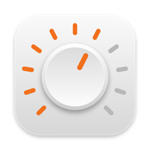

# Mando

**Volume and brightness keys that just work on an external monitor or TV connected to your Mac by HDMI or DisplayPort.** Made for Apple and Logitech keyboards (MX Keys, MX Keys S, MX Mechanical, K380…). Free and open source.

*Teclas de volumen y brillo que funcionan con un monitor o TV conectado a tu Mac por HDMI o DisplayPort, con teclados Apple y Logitech. Gratis y de código abierto. [Español abajo](#español).*

---

## The problem

When a Mac sends audio over HDMI/DisplayPort, macOS treats it as fixed volume: the volume keys show a crossed-out speaker and you can't change the volume of your monitor or TV from the Mac. The brightness keys do nothing on most third-party displays (LG, Dell, Samsung, BenQ…) either.

Existing workarounds change the volume **on the monitor itself** over DDC. That makes the monitor pop its own on-screen volume bar every time and moves the monitor's global volume.

## What Mando does

- **Volume, the Mac way.** Mando installs a tiny virtual audio device with a real volume control. Audio goes through it and on to your HDMI device. The volume keys change the Mac's volume and show the macOS volume indicator. The monitor's volume stays where you set it and acts as a ceiling, and the monitor never shows its own bar.
- **Brightness over DDC/CI.** The brightness keys change the monitor's real backlight and show the macOS brightness indicator. Hold <kbd>⇧</kbd><kbd>⌥</kbd> for finer steps.
- **Automatic.** Pick your monitor as the output and Mando wraps it. Pick speakers or AirPods (devices that already have volume) and Mando gets out of the way.
- **Menu bar.** Volume and brightness sliders and an output picker. Mando opens at login, so it is still there after a restart; you can turn that off in the menu.

## Keyboards

Mando reads the keys macOS already knows as volume and brightness, so it does not need Logi Options+ or any keyboard software.

- **Apple keyboards** and **Logitech keyboards with Mac layout** (MX Keys, MX Keys S, MX Keys Mini, MX Mechanical, K380, K780…): the volume and brightness keys work as printed. Tested on a Logitech MX Keys S.
- **PC-layout keyboards** (Logitech K120, MX Keys in Windows mode, most USB keyboards): no brightness keys, so <kbd>Scroll Lock</kbd> and <kbd>Pause</kbd> (F14/F15 on a Mac) change the brightness, like on macOS itself.
- If Logi Options+ is set to use F1–F12 as standard function keys, hold <kbd>Fn</kbd>.

A keyboard that doesn't work? [Open an issue](../../issues) with its model.

## Requirements

- macOS 14 Sonoma or later
- Apple Silicon recommended (DDC brightness uses the Apple Silicon display services). The audio part also works on Intel.
- Brightness needs a monitor with DDC/CI enabled. Some monitors accept DDC commands but can't report their current brightness over HDMI. Mando handles that and remembers the last value it set.

## Install

1. Download [Mando.zip](https://github.com/Aliasviejo/Mando/releases/latest/download/Mando.zip), unzip it and move **Mando** to Applications. It is signed with Developer ID and notarized by Apple.
2. Open Mando. It offers to install its audio driver: macOS asks for your password once.
3. Grant the **Accessibility** permission macOS asks for, so Mando can read the brightness and volume keys.

If you use MonitorControl, FineTune, SoundSource or similar apps, quit them so they don't fight over the keys.

To uninstall, choose **Desinstalar Mando…** in the menu bar. It removes the driver and the app.

### From Terminal

```bash
curl -fsSL https://github.com/Aliasviejo/Mando/releases/latest/download/Mando.zip -o /tmp/Mando.zip \
  && ditto -x -k /tmp/Mando.zip /Applications && open /Applications/Mando.app
```

## FAQ

**Why can't I change the volume on my HDMI or DisplayPort monitor from my Mac?**
macOS sends digital audio over HDMI/DisplayPort at a fixed level and leaves volume to the monitor, so the volume keys show a crossed-out speaker. Mando adds a virtual audio device with its own volume control in front of the monitor, so the keys work again.

**Why don't the brightness keys work on my external monitor?**
macOS only controls the brightness of Apple displays. Most other monitors (LG, Dell, Samsung, BenQ…) accept brightness commands over DDC/CI, which Mando sends when you press the keys. Turn on DDC/CI in the monitor's menu if it's off.

**Does it work with my Logitech keyboard?**
Yes, without Logi Options+. See [Keyboards](#keyboards).

**Is it free? Is it safe?**
Free and open source (MIT). The app is signed with Developer ID and notarized by Apple. It never records audio (it needs no microphone permission) and has no network access.

## Build from source

You need Xcode (or the Command Line Tools).

```bash
./scripts/build.sh          # ad-hoc signed, for local use
./scripts/install.sh        # or just open build.noindex/Mando.app
```

The driver's playback and clock logic has a test that runs in simulated time:

```bash
clang -O2 -framework CoreFoundation -framework CoreAudio tests/forwarding_test.c -o build.noindex/forwarding_test && build.noindex/forwarding_test
```

Release build, signed with Developer ID, notarized and stapled (requirements in the script header):

```bash
VERSION=0.3.2 ./scripts/release.sh   # → build.noindex/release/0.3.2/Mando.zip
```

## How it works

```
apps ──▶ Mando (virtual device, volume applied) ──▶ HDMI monitor
                          ▲                 ▲
                 volume keys / macOS        Mando.app chooses the monitor
```

- `Driver/MandoDriver.c` is a CoreAudio AudioServerPlugIn. It publishes an output device with volume and mute controls, applies the gain to the mix and plays the result on the monitor, keeping its own clock in step with the monitor's. It has no input side, so nothing records. It ships inside the app and `DriverInstaller.swift` copies it to `/Library/Audio/Plug-Ins/HAL`.
- `App/Sources/AudioRouter.swift` makes Mando the system output when the Mac plays on a fixed-volume device, and tells the driver which device to play on.
- `App/Sources/DDC.swift` talks DDC/CI (VESA MCCS, VCP `0x10`) through `IOAVService`.
- `App/Sources/MediaKeys.swift` is a `CGEventTap` that handles the media keys.

Thanks to [MonitorControl](https://github.com/MonitorControl/MonitorControl) (MIT) for documenting DDC on Apple Silicon.

## License

[MIT](LICENSE) © Aliasviejo

---

## Español

### El problema
Cuando la Mac manda el audio por HDMI o DisplayPort, macOS bloquea el volumen: las teclas muestran un parlante tachado y no puedes subir ni bajar el volumen del monitor o la TV desde la Mac. Las teclas de brillo tampoco funcionan con la mayoría de monitores (LG, Dell, Samsung, BenQ…). Las apps que existen cambian el volumen **del monitor** por DDC. Por eso el monitor muestra su propio indicador encima cada vez.

### Qué hace Mando
- **Volumen como en la Mac:** un dispositivo de audio virtual con volumen real. Las teclas mueven el volumen de macOS con el indicador de macOS. El volumen del monitor queda fijo como tope, y el monitor no muestra su indicador.
- **Brillo por DDC/CI:** las teclas de brillo cambian el brillo real del monitor, con el indicador de macOS. Con <kbd>⇧</kbd><kbd>⌥</kbd> los pasos son más finos.
- **Automático:** si eliges el monitor como salida, Mando se encarga. Con parlantes o AirPods se hace a un lado.
- **Barra de menú:** controles de volumen y brillo y selector de salida. Mando se abre al iniciar sesión, así sigue ahí después de reiniciar; puedes desactivarlo en el menú.

### Teclados
Funciona sin Logi Options+ ni otro programa del teclado.
- **Teclados Apple y Logitech con distribución Mac** (MX Keys, MX Keys S, MX Keys Mini, MX Mechanical, K380, K780…): las teclas de volumen y brillo funcionan como están marcadas. Probado con un Logitech MX Keys S.
- **Teclados con distribución de PC** (Logitech K120, MX Keys en modo Windows, la mayoría de teclados USB): no tienen teclas de brillo, así que <kbd>Scroll Lock</kbd> y <kbd>Pause</kbd> (F14 y F15 en la Mac) cambian el brillo, igual que en macOS.
- Si Logi Options+ usa F1–F12 como teclas de función, mantén presionada <kbd>Fn</kbd>.

¿Tu teclado no funciona? [Abre un issue](../../issues) con el modelo.

### Instalar
1. Descarga [Mando.zip](https://github.com/Aliasviejo/Mando/releases/latest/download/Mando.zip), descomprímelo y mueve **Mando** a Aplicaciones. Está firmada con Developer ID y notarizada por Apple.
2. Abre Mando. Te ofrece instalar su driver de audio y macOS te pide la contraseña una vez.
3. Acepta el permiso de **Accesibilidad**, que Mando necesita para leer las teclas de brillo y volumen.

Si usas MonitorControl, FineTune o SoundSource, ciérralas para que no peleen por las teclas. Para desinstalar, elige **Desinstalar Mando…** en la barra de menú.

Desde Terminal:

```bash
curl -fsSL https://github.com/Aliasviejo/Mando/releases/latest/download/Mando.zip -o /tmp/Mando.zip \
  && ditto -x -k /tmp/Mando.zip /Applications && open /Applications/Mando.app
```

### Preguntas frecuentes

**¿Por qué no puedo cambiar el volumen de mi monitor HDMI o DisplayPort desde la Mac?**
macOS manda el audio digital por HDMI o DisplayPort a un nivel fijo y deja el volumen al monitor, por eso las teclas muestran un parlante tachado. Mando pone delante del monitor un dispositivo de audio virtual con volumen propio, y las teclas vuelven a funcionar.

**¿Por qué no funcionan las teclas de brillo con mi monitor externo?**
macOS solo controla el brillo de las pantallas de Apple. La mayoría de los otros monitores (LG, Dell, Samsung, BenQ…) aceptan órdenes de brillo por DDC/CI, y Mando las manda al presionar las teclas. Si está apagado, activa DDC/CI en el menú del monitor.

**¿Funciona con mi teclado Logitech?**
Sí, sin Logi Options+. Mira la sección [Teclados](#teclados).

**¿Es gratis? ¿Es segura?**
Gratis y de código abierto (MIT). Está firmada con Developer ID y notarizada por Apple. Nunca graba audio (no pide permiso de Micrófono) y no se conecta a internet.
